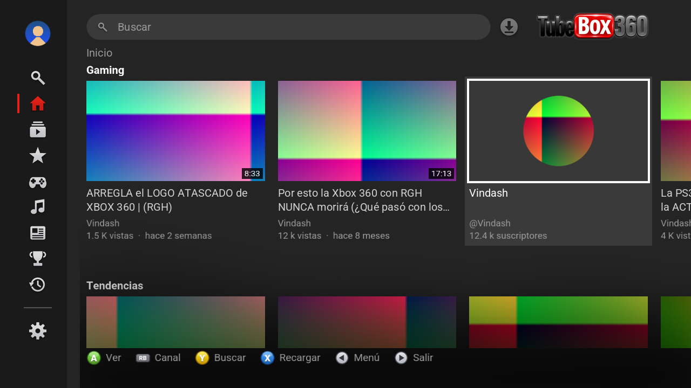
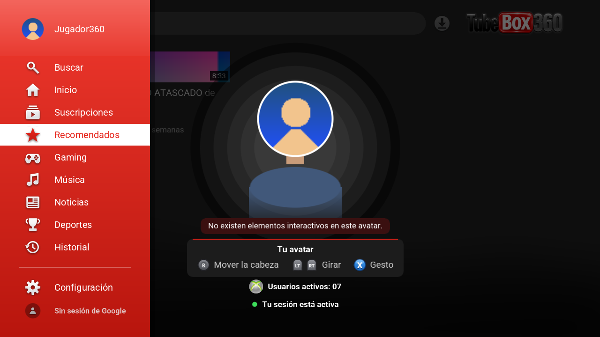
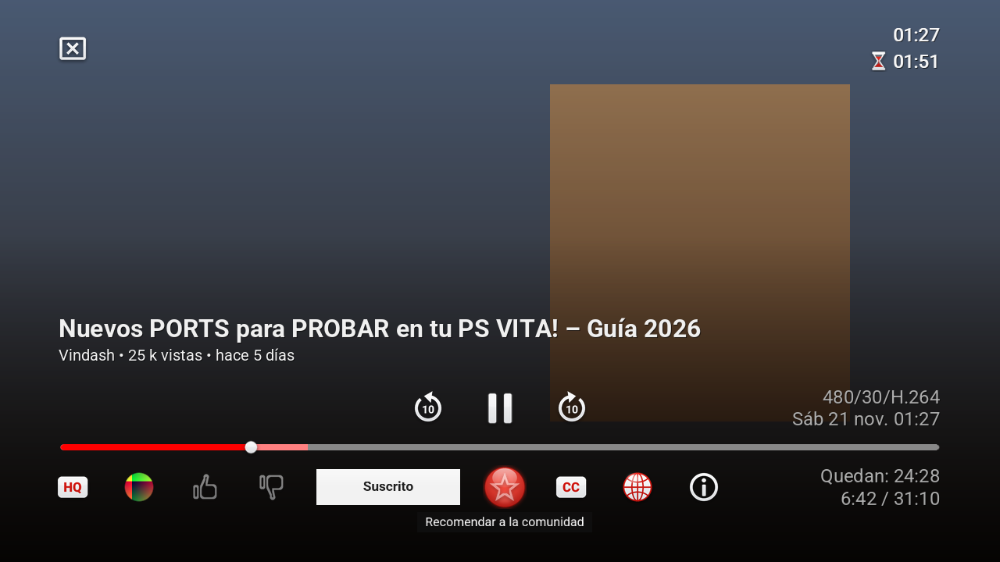
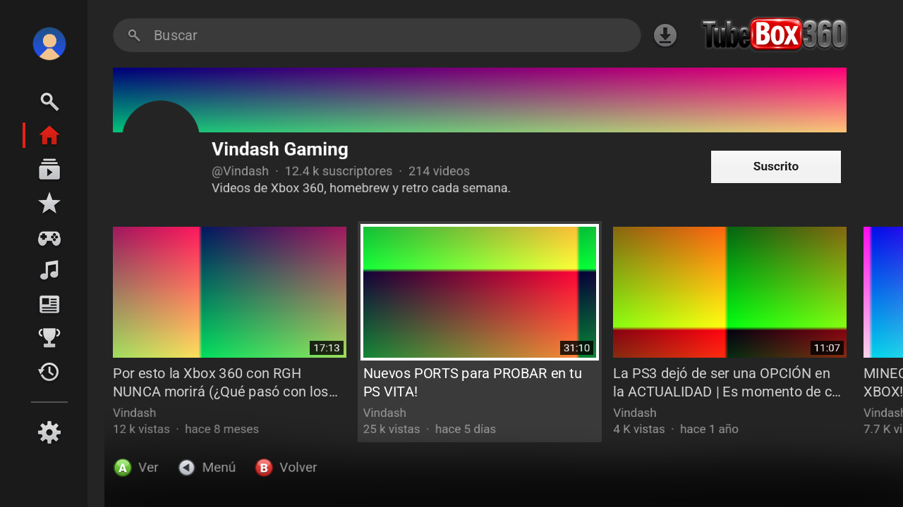
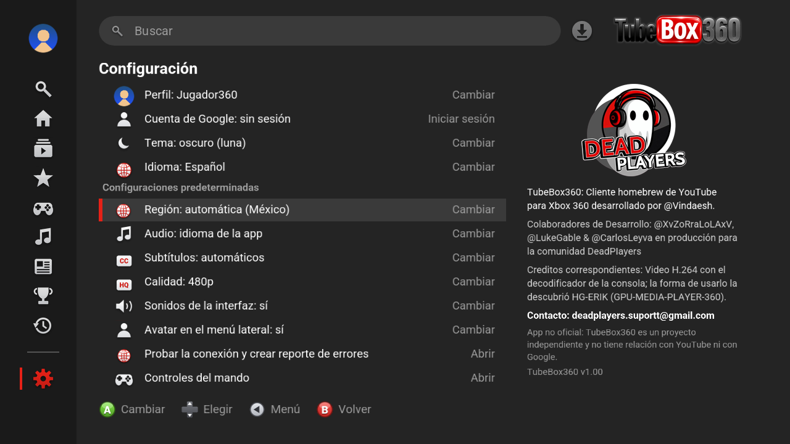

# TubeBox360

Cliente **homebrew** de YouTube para **Xbox 360** (RGH / JTAG), escrito en C (C89) con el XDK de Xbox 360.
Reproduce video H.264 con el decodificador por hardware de la consola y se conecta por **HTTPS directo** desde la propia Xbox, sin PC de por medio.

> **App no oficial.** TubeBox360 es un proyecto independiente y **no tiene relación con YouTube, Google ni Microsoft**. YouTube es una marca de Google LLC; Xbox 360 es una marca de Microsoft.

*English summary below.*

| Inicio | Menú lateral | Reproductor |
|---|---|---|
|  |  |  |

| Página de canal | Configuración |
|---|---|
|  |  |

## Funciones

- **Inicio, búsqueda (40 resultados), Gaming, Música, Noticias, Deportes e Historial** en cuadrícula de tarjetas, estilo YouTube TV.
- **Reproductor propio**: hasta **1080p30 / 720p60** con el decodificador H.264 de la GPU, audio AAC, adelantar/retroceder, cola de "siguiente video".
- **Pistas de audio** (original y doblajes: español, inglés, portugués, japonés, árabe) y **subtítulos**.
- **Teclado en pantalla** con sugerencias y teclado árabe.
- **Idiomas de la app**: español, inglés, portugués, japonés y árabe. **Región** seleccionable.
- **Cuenta de Google (opcional)**: inicio de sesión por código (google.com/device), **Suscripciones**, **Me gusta / No me gusta** y **Suscribirse**.
- **Recomendados por la comunidad**: marca un video con la ⭐ y aparece para todos (los 10 más recientes).
- **Usuarios activos** en tiempo real y **aviso de versión nueva** con descarga a la carpeta `Actualizacion`.
- **Avatar 3D** del perfil junto al menú lateral.
- **Prueba de red y reporte de errores** para los usuarios.
- **HTTPS verificado** con las raíces de Google Trust Services (mbedTLS).

## Instalación (usuarios)

1. Descarga `default.xex` de la sección **Releases**.
2. Cópialo a una carpeta de tu consola (por ejemplo `Hdd1:\Apps\TubeBox360\`).
3. Ábrelo desde **Aurora** o **XeXMenu**.

Requiere una Xbox 360 con **RGH/JTAG** y conexión a internet.

### Reportar errores
En la app: **Configuración → Probar la conexión y crear reporte de errores**. Se crea `TubeBox360_reporte.txt` junto al `.xex`; mándalo (junto con `errores.txt`) a **deadplayers.suportt@gmail.com** o abre un *Issue* aquí.

## Compilar (desarrolladores)

Necesitas **Visual Studio 2010** con el **XDK de Xbox 360** (2.0.21256). El XDK es software de Microsoft y **no se incluye** en este repositorio.

Estructura:

| Carpeta | Qué es |
|---|---|
| `TubeBox360/` | Código de la app |
| `mbedtls360/` | mbedTLS 2.28.8 adaptado a C89 / Xbox 360 (librería estática) — ver `mbedtls360/PARCHES.txt` |
| `ffaac/` | Envoltura del decodificador AAC de FFmpeg (librería estática) |
| `tools/` | Scripts de Python que generan `ui_assets.c`, `lang_tab.h`, `font_extra.c` y `tls_roots.c` (no van en Visual Studio) |
| `firebase/` | Reglas de la base de datos y ejemplo del aviso de versión |

Pasos:

1. Descarga **ffmpeg360** (el port de FFmpeg para Xbox 360 de **HG-ERIK**) y ponlo al lado de estas carpetas como `ffmpeg360/` (lo usa `ffaac`).
2. Crea la solución con los proyectos `TubeBox360`, `mbedtls360` y `ffaac`, y agrega a `TubeBox360` todos los `.c`, `.cpp` y `.h` de su carpeta.
3. En `TubeBox360` → *C/C++ → Additional Include Directories*: `..\mbedtls360\include;..\mbedtls360\compat`.
4. Referencias: `mbedtls360` y `ffaac` (*References → Add New Reference*).
5. Configuración **Release**; el `.xex` resultante se copia a la consola como `default.xex`.

### Servicios opcionales (`TubeBox360/version.h`)

Sin llenar nada, la app funciona (buscar, ver, Inicio). Para las funciones en línea:

- `TB_PRESENCE_URL`: dirección de **tu** Firebase Realtime Database (usuarios activos, recomendados y aviso de versión). Publica las reglas de `firebase/reglas.json`.
- `TB_GOOGLE_CLIENT_ID` / `TB_GOOGLE_CLIENT_SECRET`: cliente OAuth de **tu** proyecto de Google Cloud, tipo *TVs and Limited Input devices*, con la **YouTube Data API v3** habilitada y el permiso `.../auth/youtube`.

**No subas tus claves** a un repositorio público.

## Créditos

- Desarrollo: **@Vindaesh**
- Colaboradores: **@XvZoRraLoLAxV**, **@LukeGable**, **@CarlosLeyva**
- Comunidad: **DeadPIayers**
- Decodificación de video por la GPU de la consola: basada en lo que descubrió **HG-ERIK** (GPU-MEDIA-PLAYER-360); audio AAC con su port de FFmpeg.
- Contacto: **deadplayers.suportt@gmail.com**

Licencias de terceros: ver [THIRD_PARTY.md](THIRD_PARTY.md).

## Licencia

[GNU GPL v3](LICENSE).

---

## English summary

**TubeBox360** is an unofficial homebrew YouTube client for modded Xbox 360 consoles (RGH/JTAG), written in C89 with the Xbox 360 XDK. It plays H.264 video (up to 1080p30 / 720p60) through the console's hardware decoder and talks HTTPS directly (mbedTLS, certificate-verified) — no PC proxy needed. Features: YouTube TV–style grid UI, audio tracks and subtitles, 5 UI languages, selectable region, optional Google sign-in (device code) for subscriptions, likes and subscribing, community recommendations, live user counter, update notifier, 3D avatar, and built-in network test / error report.

Not affiliated with YouTube, Google or Microsoft. The Xbox 360 XDK is not included. Licensed under the GPL v3.
